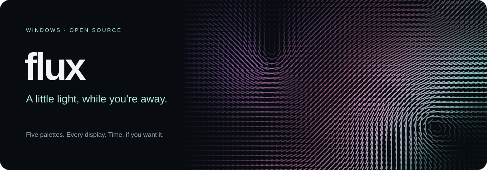

# Flux

A Windows screensaver with flowing, GPU-rendered light. Based on [Luma by Kenan Kasumović](https://github.com/Ken5998/luma), itself based on [Flux by Sander Melnikov](https://github.com/sandydoo/flux), inspired by the Drift screensaver on macOS.

Flux is an independent MIT-licensed fork, currently under development.

## Features

- Fullscreen animation on each display connected at startup.
- Independent scenes with per-monitor resolution and DPI scaling.
- Five color palettes, including Aurora: teal, violet, and pink inspired by northern lights.
- Hidden cursor in screensaver mode.
- Exit all screens with a key press, mouse click, scroll, or mouse movement.
- A two-second input grace period after each window's first frame prevents accidental startup exits. Keyboard auto-repeat is ignored; mouse movement uses an 8-logical-pixel threshold.
- A windowed desktop mode for development and testing.
- Stops drawing while Windows has turned the display off, and resumes when it comes back on.
- The small preview in Windows Screen Saver Settings shows a scaled-down full scene with thicker lines, at low quality and 30 fps.

## Build

The only build output you need is `Flux.exe`. There are no prebuilt downloads or installers. Flux is Windows-only: building for another target stops with a compile error.

`Flux.exe` renders with Direct3D 12 only, which keeps it small (about 5 MB). It needs Windows 10 or 11; without a DirectX 12 GPU, Windows' built-in WARP software renderer is used.

### On Windows

Requires a stable Rust toolchain (rustup) and Visual Studio Build Tools with the C++ x64 tools and Windows SDK.

```powershell
cargo build --release -p flux-desktop
```

Result: `target\release\Flux.exe`.

### On Linux, for Windows

Requires clang, lld and llvm (for `clang-cl`, `lld-link` and `llvm-rc`), plus [cargo-xwin](https://github.com/rust-cross/cargo-xwin), which downloads the Windows SDK on first use.

```bash
rustup target add x86_64-pc-windows-msvc
cargo install --locked cargo-xwin
XWIN_ACCEPT_LICENSE=1 cargo xwin build --release -p flux-desktop --target x86_64-pc-windows-msvc
```

Result: `target/x86_64-pc-windows-msvc/release/Flux.exe`.

The icon (`flux-desktop/Flux.ico`) is embedded in the executable.

## Run

```powershell
.\Flux.exe            # windowed
.\Flux.exe /s         # fullscreen screensaver on all displays
.\Flux.exe /c         # settings window
```

To use it as the Windows screensaver, copy `Flux.exe` to `Flux.scr`, then right-click `Flux.scr` and choose **Install**.

### Command-line modes

| Argument | Current behavior |
| --- | --- |
| `/s` | Fullscreen screensaver on every display detected at startup |
| `--windowed` | Windowed desktop prototype |
| `/c` | Open the settings window |
| `/p <HWND>` or `/p:<HWND>` | Animated preview embedded in the supplied Windows window; follows its size and exits when the host closes |
| No arguments | Windowed mode for `.exe`; settings window for `.scr` |

## Settings

Open **Settings** in Windows Screen Saver Settings, or run `Flux.exe /c`.

- **Kleurenpalet** (Color palette): Original, Plasma, Poolside, Freedom, or Aurora.
- **Animatiesnelheid** (Animation speed): 50–200% of the default speed.
- **Lijndikte** (Line size): 50–200%, independent of display DPI.
- **Simulatiekwaliteit** (Simulation quality): Laag, Gemiddeld (default), or Hoog. Higher quality uses more GPU resources on each display.
- **Beelden per seconde** (Frame rate): 30, 60 (default), or the display refresh rate. On 120/144 Hz displays the 60 fps limit saves GPU power without changing the animation speed; displays at or below the limit simply follow vsync.
- **Videokaart** (GPU): Zuinig (default, prefers the integrated GPU on laptops with two GPUs) or Snelste videokaart.

The settings window is in Dutch. **Opslaan** (Save) writes preferences to `%LOCALAPPDATA%\Flux\settings.json`. **Annuleren** (Cancel) leaves the file unchanged. **Standaardwaarden** (Restore defaults) resets the controls; use Opslaan to keep those values.

Preferences apply when a new desktop, screensaver, or preview instance starts. A running animation is not updated live. Missing settings use defaults; unreadable or invalid files produce a log warning and safe defaults. Saving from the settings window replaces invalid files.

The settings window is a native Windows dialog built into `Flux.exe`; it needs no PowerShell or other components. Tab moves between fields, Enter saves and Esc cancels.

## Tests

Run the tests on Windows:

```powershell
cargo test --locked --release -p flux -p flux-desktop
```

GPU tests are ignored by default. Run them separately:

```powershell
cargo test --locked --release -p flux -p flux-desktop -- --ignored --test-threads=1
```

## Diagnostics

Flux writes `%LOCALAPPDATA%\Flux\Flux.log` (next to `settings.json`), including the selected GPU, frame interval, detected displays, the first rendered frame on each display, and input-triggered exits. The file is overwritten on each launch. If the GPU cannot be started, Flux closes cleanly and logs the reason; the windowed app also shows it in a dialog.

Losing focus does not close the screensaver.

## Current limits

- Display hot-plug: restart Flux after connecting or disconnecting a monitor.
- All displays share one GPU device, but each runs its own simulation; scenes do not span display boundaries.

## Repository structure

| Directory | Purpose |
| --- | --- |
| `flux/` | GPU renderer, shaders, and simulation tests |
| `flux-desktop/` | `Flux.exe`: screensaver, native settings window, icon, manifest, and desktop tests |
| `docs/` | README banner |

## Credits and license

This project is derived from [Luma](https://github.com/Ken5998/luma) (copyright © 2026 Kenan Kasumović), which in turn is derived from the original [Flux](https://github.com/sandydoo/flux) (copyright © 2021 Sander Melnikov), both under the [MIT license](LICENSE). Original rendering work remains credited to Flux and its author. The banner is an SVG asset created for the Luma fork.
